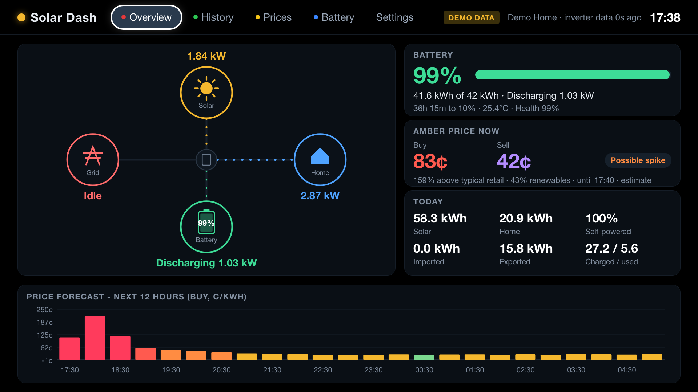
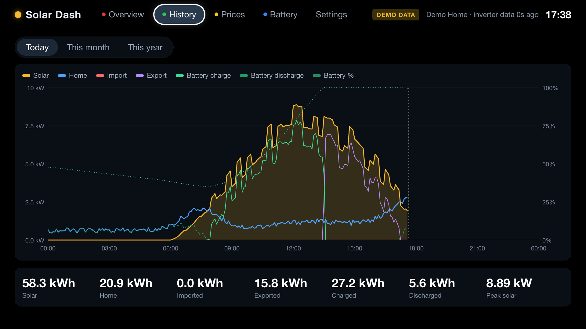
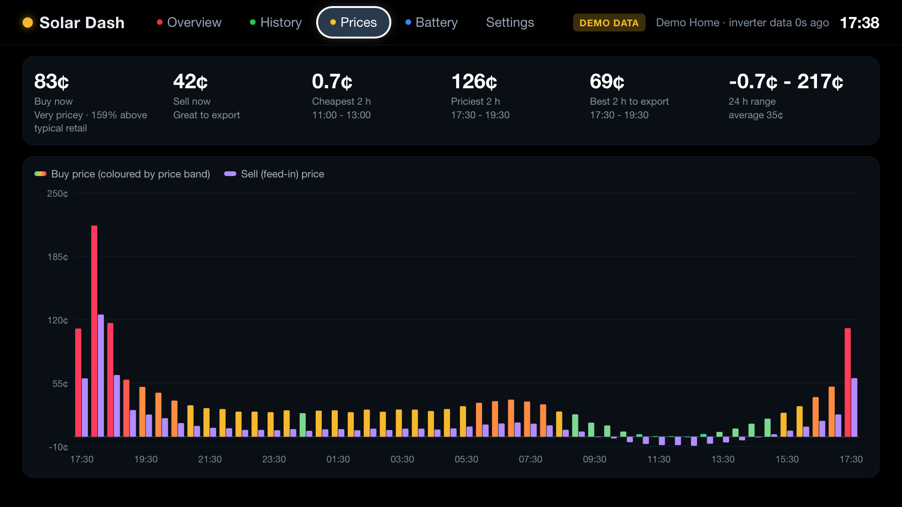
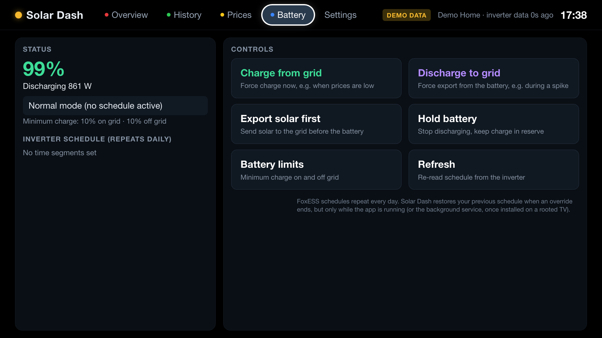
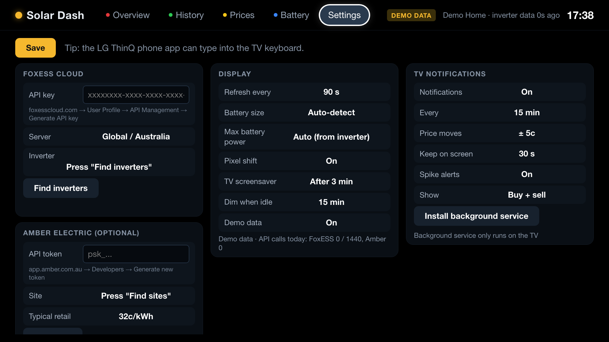

# Solar Dash for FoxESS

A home-energy dashboard and battery remote for LG webOS TVs. It shows live data from your FoxESS inverter and battery alongside Amber Electric prices, lets you force-charge or force-discharge the battery from the couch, and can pop the current price up over Netflix or any other input.



> Unofficial. Not affiliated with or endorsed by FoxESS, Amber Electric or LG. Battery controls send real commands to your inverter, so use them at your own risk.

## Features

- **Overview:** an animated energy-flow diagram (solar, home, battery, grid), battery charge level and time to full or empty, Amber buy and sell price now, today's totals and a 12-hour price forecast.
- **History:** today's power curves and battery %, daily energy for this month, and monthly energy for this year.
- **Prices:** Amber's 24-hour buy and sell forecast, the cheapest and most expensive 2-hour windows, and the best 2 hours to export.
- **Battery controls:** charge from grid, discharge to grid, export solar first, hold battery, and minimum-charge limits. Every action asks for confirmation and then reads the inverter's schedule back.
- **Honest price bands:** prices are labelled against your own last 4 weeks of Amber prices, not Amber's wholesale-based "very low".
- **TV notifications (rooted TVs):** e.g. "Buy 26c · Sell 7c" over any app or HDMI input, on a timer, when the price moves, and straight away when a spike starts. Notifications never take the remote.
- **OLED care:** pixel shift, dim-when-idle, and control over how long LG's screensaver waits while the dashboard is open.
- **Demo mode:** realistic simulated data, so you can try it without an inverter.

| History | Prices |
|---|---|
|  |  |
| **Battery** | **Settings** |
|  |  |

### Compatibility

- **TVs:** LG webOS 3.5 (2017) and newer. Developed and tested on a 2017 OLED65C7T.
- **Inverters:** FoxESS hybrid inverters on FoxESS Cloud whose Open API supports the scheduler (H1, H3, H3 Pro, H3 Smart, KH). Tested with an H3 Smart and a 42 kWh battery.
- **Prices:** Amber Electric (optional).

## Install

Download the `.ipk` from the [latest release](../../releases/latest).

### Rooted TV (recommended)

Root the TV with [RootMyTV / DejaVuln](https://cani.rootmy.tv) to get the Homebrew Channel. Then install the `.ipk` in either of two ways:

- Use [webOS Dev Manager](https://github.com/webosbrew/dev-manager-desktop).
- Use SSH:

```bash
scp com.solardash.tv_*.ipk root@TV_IP:/tmp/solardash.ipk
```

```bash
ssh root@TV_IP 'luna-send -n 1 luna://com.webos.appInstallService/dev/install "{\"id\":\"com.ares.defaultName\",\"ipkUrl\":\"/tmp/solardash.ipk\",\"subscribe\":true}"'
```

### Developer Mode (no root)

The dashboard and battery controls work without root, but TV notifications don't. Developer Mode sessions also expire after 50 hours unless you extend them.

1. Install **Developer Mode** from the LG Content Store and sign in with a free LG developer account.
2. Turn on Dev Mode and Key Server.
3. From a computer with this repo, run:

```bash
npm install
```

```bash
npx ares-setup-device
```

```bash
npx ares-install com.solardash.tv_*.ipk
```

## Setup

1. **FoxESS API key:** log in at foxesscloud.com, then go to **User Profile → API Management → Generate API key**.
2. **Amber token (optional):** in app.amber.com.au, go to **Developers → Generate new token**.
3. In Solar Dash, open **Settings** and enter the key, then press **Find inverters**. Do the same for Amber with **Find sites**, then press **Save**.
4. **Rooted TVs:** in **Settings → TV notifications**, press **Install background service**, then **Send test**.

To type the keys, press OK on a text field to open the TV keyboard. The **LG ThinQ** phone app can type into that keyboard, which is much easier for long keys.

### Remote

| Key | Action |
|---|---|
| Arrows / OK | Move and select |
| OK, then ‹ › | Change a setting (OK or Back to finish) |
| Red / Green / Yellow / Blue | Overview / History / Prices / Battery |
| 1-5 | Jump to a tab |
| Back | Close dialog, go to Overview, or exit |

## Price bands

Amber's own labels rate prices against the wholesale market, so a normal retail price can show as "very low". Solar Dash instead ranks each buy price against **your last 4 weeks of Amber prices**:

| Band | Where it falls in your last 4 weeks |
|---|---|
| Very cheap | Cheapest 10% |
| Cheap | Next 20% |
| Typical | Middle 40% |
| Pricey | Next 20% |
| Very pricey | Top 10% |

The bands are also checked against a typical retail price, 32c/kWh by default (roughly the 2025-26 national average, and adjustable in Settings):

- A price at or above that is never labelled cheaper than "Typical".
- A price 50% or more above it is never labelled cheaper than "Pricey".

Sell prices are banded the same way, where a higher price is better.

## TV notifications (rooted TVs)

**Settings → TV notifications → Install background service** adds a small daemon. The Homebrew Channel starts it at boot from `/var/lib/webosbrew/init.d/solardash`.

What it does:

- Shows the Amber price as an LG notification over any app or input, choosing between buy + sell, + battery %, + solar, or everything.
- Sends one on a timer, when the price moves by a set amount, and straight away when a spike starts.
- Keeps each notification on screen for 5 s up to "always" by re-sending it every 4 s, and stops as soon as the screensaver or standby starts. LG fixes the position at the top right. "Always" leaves a static box on an OLED, so it carries a burn-in risk.
- Restores your FoxESS schedule when a battery override ends, even if the app is closed.

**Uninstall** in the same panel removes the daemon.

Details:

- The daemon listens only on `127.0.0.1:8643`.
- It stores its settings in `/home/root/.solardash` (root-only) and logs to `/tmp/solardash-daemon.log`.

## How battery overrides work

FoxESS Cloud has no "do this once" command. Overrides use the inverter's **scheduler** time segments, and **those repeat every day**. Solar Dash handles this as follows:

1. It backs up your existing schedule.
2. It writes a temporary segment, e.g. Force Charge 14:00-16:00 at 10 kW, stopping at 95%.
3. It restores your backup when the override ends.

With the background service installed, the restore happens on time even when the app is closed. Without it, the restore happens only while the app is running, or the next time it opens. Until then the segment stays on the inverter and **will run again the next day at the same time**.

## Data freshness and API limits

FoxESS Cloud only receives new data from the inverter every few minutes (every 5 minutes on an H3 Smart). Solar Dash learns that rhythm and checks about 20 seconds after each expected update, and the header shows how old the inverter data is.

This stays well inside FoxESS's limit of **1,440 calls per inverter per day**. Polling pauses while the app is in the background. **Settings** shows today's call count.

## Develop

```bash
npm install
```

```bash
npm run dev
```

The dev server serves the app at http://localhost:8642. It shows demo data until you add keys; add `?demo=1` to force demo data or `&tab=prices` to open a tab.

```bash
npm run package
```

- `app/`: the web app. It's hand-written **ES5 with no build step**, because webOS 3.x runs a Chromium 38-era engine: no arrow functions, `let`/`const`, `fetch` or CSS variables.
- `service/`: a webOS JS service (Node 0.12 on old TVs). FoxESS Cloud doesn't allow browser requests (no CORS), so the service signs and forwards every FoxESS and Amber call. It carries its own root certificates for older firmware.
- `service/daemon.js` + `service/init/solardash.sh`: the root background daemon for notifications and override restores.
- `dev/server.js`: serves `app/` and exposes the same proxy as the TV service.

The FoxESS request signature is `md5(path + "\r\n" + apiKey + "\r\n" + timestamp)`, where `\r\n` is the **literal four characters** backslash-r-backslash-n, as in FoxESS's reference code.

Pull requests are welcome, especially testing with other FoxESS models and newer webOS versions.

## Roadmap

- **Movable price box on HDMI inputs:** joining the HDMI input's window group, as LG's LivePlus does, so the remote keeps working. Over apps like Netflix, webOS 3.5 gives an overlay the remote, which is why notifications are used there.
- **Local Modbus TCP** for live data every few seconds instead of FoxESS Cloud's 5 minutes.
- **More price sources:** GloBird and other retailers via a manual tariff plus AEMO wholesale prices for spike alerts.

## License

MIT
